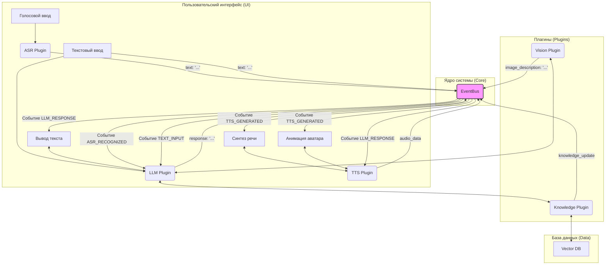

# Архитектура оффлайн ИИ-ассистента

Этот документ описывает модульную архитектуру, компоненты и потоки данных для полностью оффлайн работающего ИИ-ассистента.

## 1. Принципы архитектуры

*   **LEGO-модульность**: Каждый функциональный блок (распознавание речи, LLM, синтез речи и т.д.) является независимым модулем (плагином). Это позволяет легко заменять, обновлять или отключать компоненты.
*   **Событийная модель (Event-Driven)**: Модули не взаимодействуют друг с другом напрямую. Вместо этого они общаются через центральную шину событий (`EventBus`). Один модуль генерирует событие (например, `SPEECH_RECOGNIZED`), а другие модули, подписанные на это событие, реагируют на него.
*   **Полная оффлайн-работа**: Ни один компонент не требует доступа к интернету. Все модели и данные хранятся и обрабатываются локально.
*   **Кроссплатформенность**: Ядро системы пишется на Python, а для интерфейса используется фреймворк, поддерживающий Windows, Linux и Android.

## 2. Схема компонентов

Ниже представлена схема взаимодействия ключевых модулей системы.



## 3. Описание модулей

### Core (Ядро)
*   **`EventBus`**: Центральный диспетчер сообщений. Принимает события от одного модуля и перенаправляет их всем подписчикам.
*   **`PluginManager`**: Загружает, инициализирует и управляет жизненным циклом всех плагинов.
*   **`main.py`**: Точка входа в приложение. Инициализирует UI, ядро и запускает главный цикл.

### Plugins (Плагины)
*   **`ASR (Automatic Speech Recognition)`**:
    *   **Событие на вход**: `MIC_AUDIO_FRAME` (получает аудиопоток).
    *   **Событие на выход**: `ASR_RECOGNIZED` (отправляет распознанный текст).
    *   **Модели**: Vosk, Whisper.cpp.
*   **`TTS (Text-to-Speech)`**:
    *   **Событие на вход**: `TTS_REQUEST` (получает текст для озвучивания).
    *   **Событие на выход**: `TTS_GENERATED` (отправляет сгенерированный аудиопоток и данные для анимации).
    *   **Модели**: Coqui TTS, Piper TTS.
*   **`LLM (Large Language Model)`**:
    *   **Событие на вход**: `ASR_RECOGNIZED`, `TEXT_INPUT`, `VISION_ANALYSIS_RESULT`.
    *   **Событие на выход**: `LLM_RESPONSE` (отправляет сгенерированный ответ).
    *   **Взаимодействует с**: `Knowledge Plugin` для получения контекста из базы знаний.
    *   **Модели**: LLaMA.cpp, Mistral, Qwen.
*   **`Vision`**:
    *   **Событие на вход**: `IMAGE_UPLOADED`.
    *   **Событие на выход**: `VISION_ANALYSIS_RESULT` (отправляет описание изображения).
    *   **Модели**: LLaVA, BLIP.
*   **`Knowledge`**:
    *   **Событие на вход**: `FILE_UPLOADED` (для обучения).
    *   **Функционал**: Парсит файлы (PDF, TXT, и др.), создает векторные представления (embeddings) и сохраняет их в `Vector DB`. Предоставляет релевантный контекст для LLM по запросу.
*   **`UI`**:
    *   **Функционал**: Отображает чат, управляет микрофоном, воспроизводит аудио, анимирует аватара. Генерирует пользовательские события (`TEXT_INPUT`, `IMAGE_UPLOADED`).

## 4. Поток данных (Пример: Голосовой вопрос)
1.  **UI** захватывает аудио с микрофона.
2.  **ASR Plugin** получает аудиопоток и преобразует его в текст.
3.  **ASR Plugin** публикует событие `ASR_RECOGNIZED` с текстом в `EventBus`.
4.  **EventBus** перенаправляет событие подписчикам.
5.  **LLM Plugin** получает событие, обрабатывает текст.
6.  **LLM Plugin** обращается к **Knowledge Plugin** за дополнительным контекстом из базы знаний.
7.  **LLM Plugin** генерирует текстовый ответ и публикует событие `LLM_RESPONSE` в `EventBus`.
8.  **EventBus** перенаправляет событие.
9.  **UI** получает событие и отображает текст ответа в чате.
10. **TTS Plugin** получает событие, генерирует аудио из текста ответа.
11. **TTS Plugin** публикует `TTS_GENERATED` с аудиоданными.
12. **UI** получает аудио и воспроизводит его.

## 5. Рекомендованные оффлайн-модели (GGUF / ONNX)

Ниже приведен список моделей, которые являются легковесными, производительными и работают полностью оффлайн. Все модели в формате GGUF могут быть запущены с использованием `llama.cpp`.

### ASR (Распознавание речи)

*   **Whisper.cpp (Рекомендуется)**
    *   **Описание**: Порт модели Whisper от OpenAI на C++. Высокая точность для русского и английского языков.
    *   **Инструкция**: Модели загружаются с помощью скрипта из репозитория.
    *   **Ссылка на репозиторий**: `https://github.com/ggerganov/whisper.cpp`
    *   **Команда для загрузки модели (например, `base`)**:
        ```bash
        bash ./models/download-ggml-model.sh base.en
        bash ./models/download-ggml-model.sh base
        ```
*   **Vosk**
    *   **Описание**: Более легковесная, но менее точная альтернатива. Отлично подходит для команд.
    *   **Ссылка на страницу моделей**: `https://alphacephei.com/vosk/models`
    *   **Прямая ссылка (RU, 48 MB)**: `https://alphacephei.com/vosk/models/vosk-model-small-ru-0.22.zip`
    *   **Прямая ссылка (EN, 40 MB)**: `https://alphacephei.com/vosk/models/vosk-model-small-en-us-0.15.zip`

### TTS (Синтез речи)

*   **Piper TTS (Рекомендуется)**
    *   **Описание**: Быстрый, легковесный и очень качественный синтез речи. Модели в формате ONNX.
    *   **Ссылка на модели**: `https://huggingface.co/rhasspy/piper-voices/tree/main`
    *   **Инструкция**: Скачайте `.onnx` и `.json` файлы для нужного голоса.
    *   **Прямая ссылка (RU, голос `irina`)**:
        *   `https://huggingface.co/rhasspy/piper-voices/resolve/main/ru/ru_RU/irina/medium/ru_RU-irina-medium.onnx`
        *   `https://huggingface.co/rhasspy/piper-voices/resolve/main/ru/ru_RU/irina/medium/ru_RU-irina-medium.onnx.json`
    *   **Прямая ссылка (EN, голос `lessac`)**:
        *   `https://huggingface.co/rhasspy/piper-voices/resolve/main/en/en_US/lessac/medium/en_US-lessac-medium.onnx`
        *   `https://huggingface.co/rhasspy/piper-voices/resolve/main/en/en_US/lessac/medium/en_US-lessac-medium.onnx.json`

### LLM (Языковая модель)

*   **Mistral 7B Instruct (Рекомендуется для EN + Code)**
    *   **Описание**: Одна из лучших моделей в категории 7B. Отлично справляется с инструкциями, кодом и английским языком.
    *   **Формат**: GGUF (q4_K_M)
    *   **Прямая ссылка**: `https://huggingface.co/TheBloke/Mistral-7B-Instruct-v0.2-GGUF/resolve/main/mistral-7b-instruct-v0.2.Q4_K_M.gguf`
*   **Saiga-Mistral 7B (Рекомендуется для RU)**
    *   **Описание**: Дообученная на русских данных Mistral. Отлично подходит для диалогов на русском языке.
    *   **Формат**: GGUF (q4_K_M)
    *   **Прямая ссылка**: `https://huggingface.co/IlyaGusev/saiga_mistral_7b_gguf/resolve/main/model-q4_K.gguf`

### Vision (Анализ изображений, Multimodal)

*   **LLaVA 1.5 7B**
    *   **Описание**: Мультимодальная модель, которая может описывать изображения. Работает в связке с LLM. Требует два файла: саму модель и проектор.
    *   **Формат**: GGUF
    *   **Прямая ссылка (Модель LLM)**: `https://huggingface.co/TheBloke/llava-v1.5-7B-GGUF/resolve/main/llava-v1.5-7b.Q4_K.gguf`
    *   **Прямая ссылка (Проектор)**: `https://huggingface.co/TheBloke/llava-v1.5-7B-GGUF/resolve/main/mmproj-model-f16.gguf`

### Embeddings (Для базы знаний)

*   **bge-small-en-v1.5 (Рекомендуется)**
    *   **Описание**: Высокоэффективная модель для создания векторных представлений (embeddings) текста для RAG.
    *   **Формат**: GGUF (q4_K_M)
    *   **Прямая ссылка**: `https://huggingface.co/TheBloke/bge-small-en-v1.5-GGUF/resolve/main/bge-small-en-v1.5-q4_k_m.gguf`
